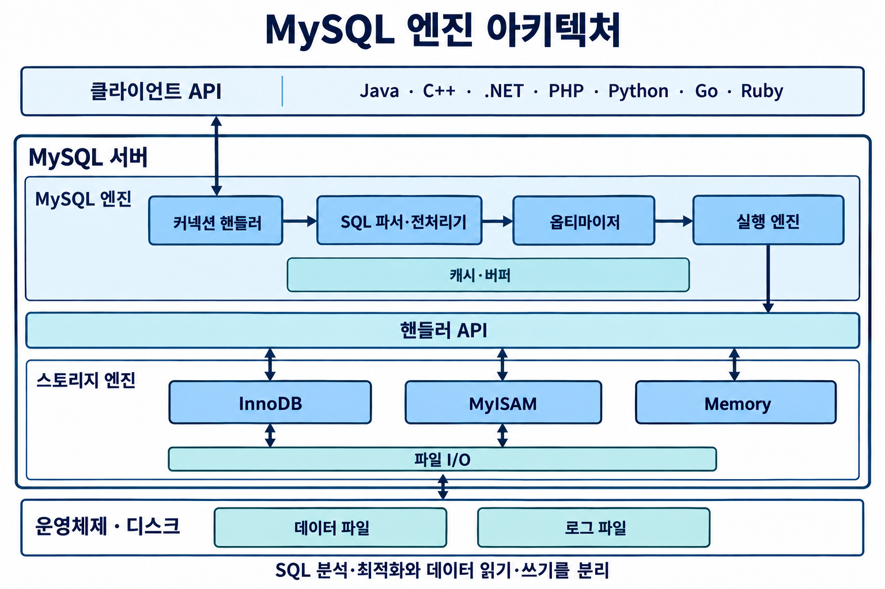
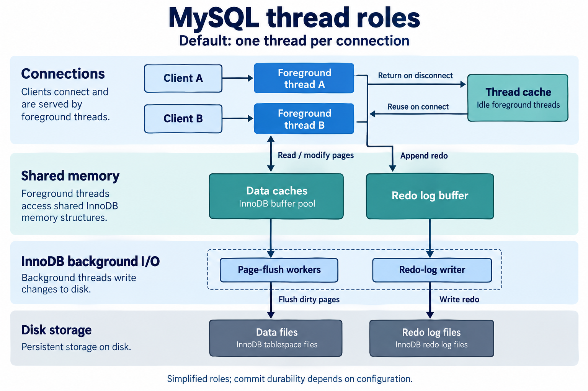
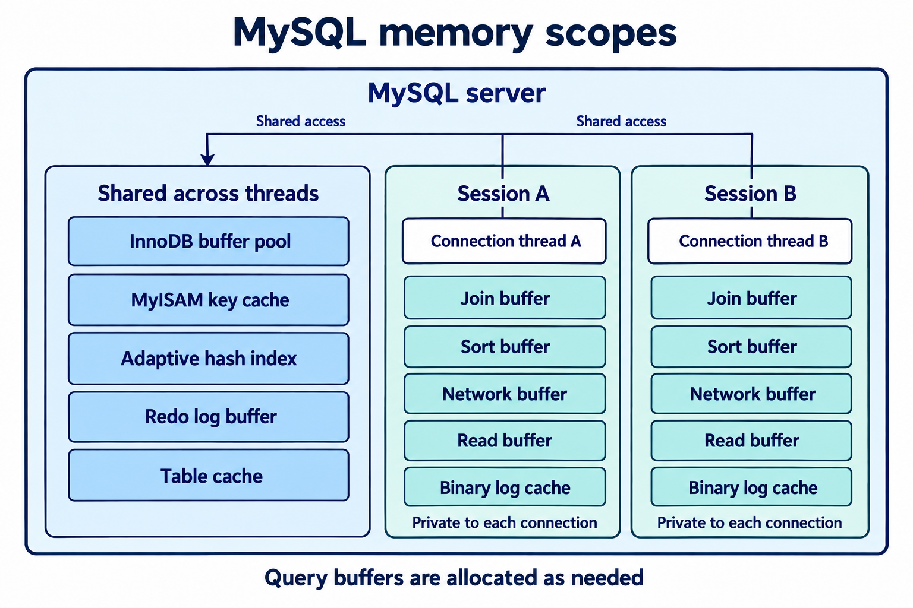
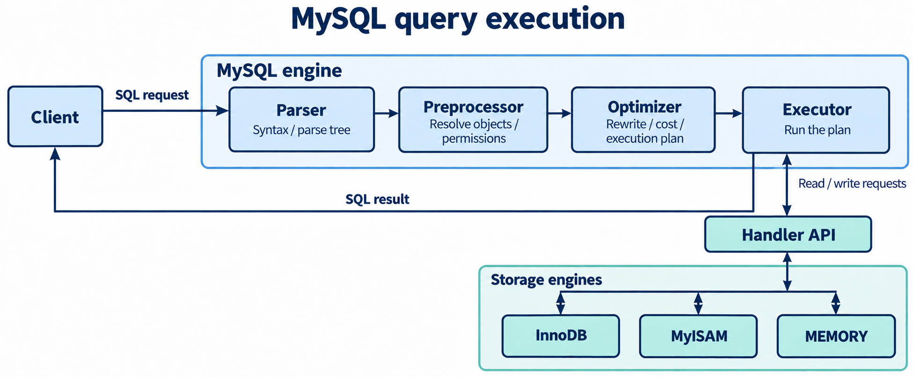
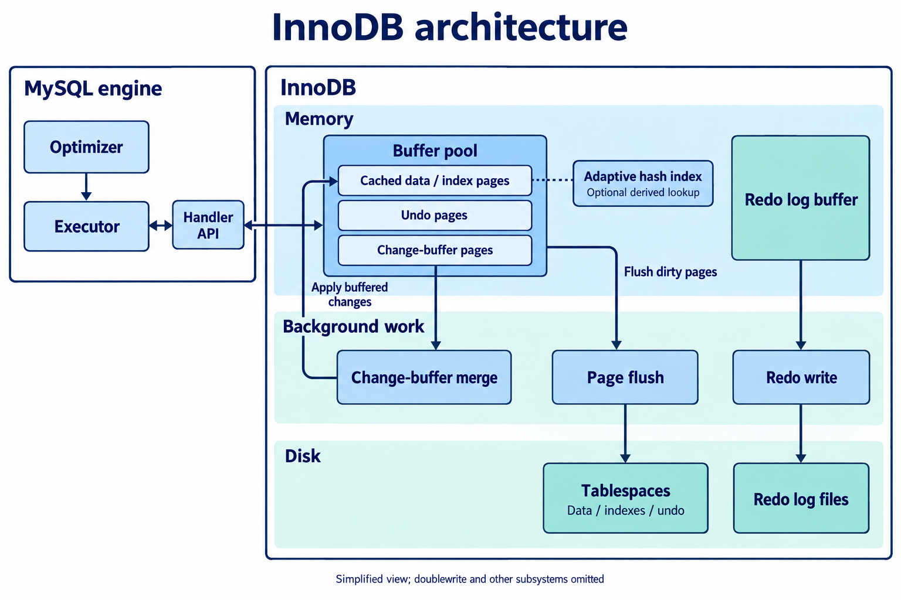

# 아키텍처
## MySQL 엔진 아키텍처
### MySQL 엔진 아키텍처
{: w="760"}

* MySQL 서버는 크게 MySQL 엔진과 스토리지 엔진으로 구분
* MySQL 엔진
    * 클라이언트로부터 접속 및 쿼리 요청을 처리하는 커넥션 핸들러, SQL 파서 및 전처리기, 쿼리의 최적화된 실행을 위한 옵티마이저가 중심
    * ANSI SQL 문법 지원
    * 요청된 SQL 문장을 분석하거나 최적화하는 등 DBMS의 두뇌 역할
    * MySQL 서버에 하나
* 스토리지 엔진
    * 실제 데이터를 디스크 스토리지에 저장하거나 디스크 스토리지로부터 데이터를 읽어오는 역할
    * MySQL 서버에 여러 스토리지 엔진을 동시에 사용 가능
    * 성능 향상을 위한 키 캐시(MyISAM), InnoDB 버퍼 풀(InnoDB) 등을 내장
* 핸들러 API
    * MySQL 엔진의 쿼리 실행기에서 데이터를 쓰거나 읽어야 할 때, 각 스토리지 엔진에 보내는 쓰기 또는 읽기 요청을 핸들러(Handler) 요청이라 함
        * 여기서 사용되는 API를 핸들러 API라고 함
        * InnoDB 스토리지 엔진 또한 이 API를 이용해 MySQL 엔진과 데이터를 주고 받음

### MySQL 스레딩 구조
{: w="760"}

* 프로세스가 아닌 스레드 기반
    * 포그라운드(Foregroud) 스레드와 백그라운드(Background) 스레드로 구분
* 포그라운드 스레드(클라이언트 스레드)
    * 최소한 MySQL 서버에 접속된 클라이언트의 수만큼 존재
        * 각 클라이언트 사용자가 요청한 쿼리 문장 처리
        * 클라이언트 사용자가 작업을 마치고 커넥션을 종료하면, 해당 커넥션을 담당하던 스레드는 다시 스레드 캐시(Thread Cache)로 돌아감
            * 스레드 캐시에 일정 개수 이상의 대기 중인 스레드가 있으면, 스레드 캐시에 넣지 않고 스레드를 종료
            * 스레드 캐시에 유지할 수 있는 최대 스레드 개수 = thread_cache_size
    * MySQL의 데이터 버퍼나 캐시로부터 데이터를 가져옴
        * 데이터가 없는 경우, 직접 디스크 데이터나 인덱스 파일로부터 데이터를 읽어옴
            * MyISAM : 디스크 쓰기 작업까지 포그라운드가 처리
            * InnoDB : 데이터 버퍼나 캐시까지만 포그라운드가 처리하고, 버퍼로부터 디스크로 기록하는 작업은 백그라운드가(지연된 쓰기)
* 백그라운드 스레드
    * InnoDB에서 다음과 같은 작업을 처리
        * 인서트 버퍼를 병합
        * 로그를 디스크에 기록
        * InnoDB 버퍼 풀의 데이터를 디스크에 기록
        * 데이터를 버퍼로 읽어옴
        * 잠금이나 데드락을 모니터링
    * 로그 스레드(Log Thread)와 버퍼의 데이터를 디스크로 내려쓰는 작업을 처리하는 쓰기 스레드(Write Thread)가 가장 중요
    * 데이터 쓰기 스레드와 읽기 스레드 개수를 2개 이상 지정 가능
        * 데이터 읽기는 주로 클라이언트 스레드가 처리하므로 읽기 스레드는 많이 필요 없음
        * 쓰기 스레드는 아주 많은 작업을 백그라운드로 처리하기 때문에 충분히 설정하는 것이 좋음
    * 사용자 요청을 처리하는 도중 데이터의 쓰기 작업은 지연(버퍼링)돼 처리될 수 있지만 읽기 작업은 지연될 수 없음
        * MyISAM은 사용자 스레드가 쓰기 작업까지 함께 처리하도록 설계
        * InnoDB에서는 CUD로 데이터가 변경되는 경우 디스크의 데이터 파일로 완전히 저장될 때까지 기다리지 않아도 되나 MyISAM은 일반적인 쿼리는 쓰기 버퍼링 기능을 사용할 수 없음

### 메모리 할당 및 사용 구조
{: w="760"}

* 글로벌 메모리 영역의 모든 메모리 공간은 MySQL 서버가 시작되면서 운영체제로부터 할당
* 글로벌 메모리 영역
    * 클라이언트 스레드 수와 무관하게 하나의 메모리 공간만 할당
        * 필요에 따라 N개의 공간을 할당받을 수도 있지만, 모든 스레드에 의해 공유
    * 대표 영역
        * 테이블 캐시
        * InnoDB 버퍼 풀
        * InnoDB 어댑티브 해시 인덱스
        * InnoDB 리두 로그 버퍼
* 로컬 메모리 영역(세션 메모리 영역)
    * 클라이언트 스레드가 쿼리를 처리하는 데 사용하는 영역
        * 커넥션 버퍼, 정렬 버퍼 등
    * 클라이언트가 MySQL 서버에 접속하면 클라이언트 커넥션으로부터의 요청을 처리하기 위해 스레드를 하나씩 할당하게 되는데, 클라이언트 스레드가 사용하는 메모리 공간이라고 해서 클라이언트 메모리 영역이라고도 함
        * 클라이언트와 MySQL 서버와의 커넥션을 세션이라고 하기 때문에 세션 메모리 영역이라고도 표현
    * 각 클라이언트 스레드별로 독립적으로 할당돼 공유되지 않음
        * 로컬 메모리 영역 크기를 신경쓰지 않고 할당할 경우, 최악의 경우 서버 메모리가 부족할 수 있음
    * 각 쿼리의 용도별로 필요할 때만 공간이 할당되고, 필요하지 않은 경우 MySQL이 메모리 공간을 할당조차 하지 않을 수도 있음
        * 소트 버퍼나 조인 버퍼 등
    * 커넥션이 열려 있는 동안 계속 할당된 상태로 남아있는 공간(커넥션 버퍼, 결과 버퍼)도 있고, 쿼리를 실행한 순간에만 할당했다가 다시 해제하는 공간(소트 버퍼, 조인 버퍼)도 있음
    * 대표 영역
        * 정렬 버퍼
        * 조인 버퍼
        * 바이너리 로그 캐시
        * 네트워크 버퍼

### 플러그인 스토리지 엔진 모델
* 스토리지 엔진 뿐만 아니라 전문 검색 엔진을 위한 검색어 파서, 사용자의 인증을 위한 Native Authentication 등이 플러그인으로 구현돼 제공
    * 사용자가 직접 스토리지 엔진을 개발하는 것도 가능
    * SQL 파서, 옵티마이저, 실행기 등은 MySQL 엔진의 처리 영역이므로 커스텀 스토리지 엔진을 만들어도 데이터 읽기/쓰기 정도 기능만 수행하게 됨
* 핸들러(Handler)
    * 어떤 기능을 호출하기 위해 사용하는 역할을 하는 객체 - MySQL 엔진이 스토리지 엔진을 조정하기 위해 사용
        * MySQL 엔진이 각 스토리지 엔진에게 데이터를 읽어오거나 저장하도록 명령하려면 반드시 핸들러를 통해야 함
    * 쿼리 처리는 MySQL 엔진에서 처리하나, 데이터 읽기/쓰기 작업 처리 방식이 스토리지 엔진에 따라 천차만별인 것을 명심

### 컴포넌트 
* 플러그인 아키텍처를 대체하기 위해 지원
* 플러그인의 단점
    * 오직 MySQL 서버와 인터페이스할 수 있고, 플러그인끼리 통신 불가
    * MySQL 서버의 변수와 함수를 직접 호출하기 때문에 안전하지 않음(캡슐화 X)
    * 상호 의존 관계를 설정할 수 없어 초기화 어려움

### 쿼리 실행 구조
{: w="760"}

* 쿼리 파서
    * 요청으로 들어온 쿼리를 토큰(MySQL이 인식할 수 있는 최소 단위의 어휘나 기호)으로 분리해 트리 형태의 구조로 만들어 내는 작업
        * 이 과정에서 쿼리의 기본 문법 오류 감지
* 전처리기
    * 파서 과정에서 만들어진 파서 트리를 기반으로 쿼리 문장에 구조적인 문제점이 있는지 확인
    * 토큰을 테이블 이름이나 칼럼 이름, 또는 내장 함수와 같은 개체를 매핑해 해당 객체의 존재 여부와 객체의 접근 권한 등을 확인하는 과정 수행
        * 실제 존재하지 않거나 권한상 사용할 수 없는 개체의 토큰 필터링
* 옵티마이저
    * 요청으로 들어온 쿼리 문장을 저렴한 비용으로 가장 빠르게 처리할지를 결정하는 역할
* 실행엔진
    *  만들어진 계획대로 각 핸들러에게 요청해서 받은 결과를 또 다른 핸들러 요청의 입력으로 연결하는 역할
    * 예시
        * 옵티마이저가 GROUP BY를 처리하기 위해 임시 테이블을 사용하기로 결정 한 경우
            * 실행 엔진이 핸들러에게 임시 테이블을 만들라고 요청
            * 다시 실행 엔진은 WHERE 절에 일치하는 레코드를 읽어오라고 핸들러에게 요청
            * 읽어온 레코드들을 준비한 임시 테이블로 저장하라고 다시 핸들러에게 요청
            * 데이터가 준비된 임시 테이블에서 필요한 방식으로 데이터를 읽어오라고 핸들러에게 다시 요청
            * 최종적으로 실행 엔진은 결과를 사용자나 다른 모듈로 넘김
* 핸들러(스토리지 엔진)
    * 핸들러는 MySQL 서버의 가장 밑단에서 MySQL 실행 엔진의 요청에 따라 데이터를 디스크로 저장하고 디스크로부터 읽어 오는 역할을 담당
        * 결국 스토리지 엔진을 의미

### 쿼리 캐시
* SQL의 실행 결과를 메모리에 캐시하고, 동일 SQL 쿼리가 실행되면 테이블을 읽지 않고 즉시 결과를 반환
    *  테이블의 데이터가 변경되면 캐시에 저장된 결과 중에서 변경된 테이블과 관련된 것들은 모두 삭제(Invalidate)해야하고, 동시 처리 성능 저하를 유발
    * 많은 버그의 원인이 되기도 함
* MySQL 8.0으로 올라오면서 쿼리 캐시는 MySQL 서버의 기능에서 완전히 제거

### 스레드 풀
* 내부적으로 사용자의 요청을 처리하는 스레드 개수를 줄여서 동시 처리되는 요청이 많다하더라도 MySQL 서버의 CPU가 제한된 개수의 스레드 처리에만 집중할 수 있게 해서 서버의 자원 소모를 줄이는 것이 목적
    * 스케줄링 과정에서 CPU 시간을 제대로 확보하지 못하는 경우에는 쿼리 처리가 더 느려지는 사례도 발생할 수 있음
    * 제한된 수의 스레드만으로 CPU가 처리하도록 적절히 유도한다면 CPU의 프로세서 친화도(Processor affinity)도 높이고 운영체제 입장에서는 불필요한 컨텍스트 스위치(Context switch)를 줄여서 오버헤드를 낮출 수 있음
        * 일반적으로는 CPU 코어의 개수와 맞추는 것이 CPU 프로세서 친화도를 높이는 데 좋음
*  MySQL 서버가 처리해야 할 요청이 생기면 스레드 풀로 처리를 이관하는데, 만약 이미 스레드 풀이 처리 중인 작업이 있는 경우에는 thread_pool_oversubscribe에 설정된 개수만큼 추가로 더 받아들여서 처리
    * 값이 너무 크면 스케줄링해야 할 스레드가 많아져서 스레드 풀이 비효율적으로 작동
* 스레드 그룹의 모든 스레드가 일을 처리하고 있다면 스레드 풀은 해당 스레드 그룹에 새로운 작업 스레드(Worker thread)를 추가할지, 아니면 기존 작업 스레드가 처리를 완료할 때까지 기다릴지 여부를 판단해야 함
    * 스레드 풀의 타이머 스레드는 주기적으로 스레드 그룹의 상태를 체크해서 thread_pool_stall_limit 시스템 변수에 정의된 밀리초만큼 작업 스레드가 지금 처리 중인 작업을 끝내지 못하면 새로운 스레드를 생성해서 스레드 그룹에 추가
        * 전체 스레드 풀에 있는 스레드의 개수는 thread_pool_max_threads 시스템 변수에 설정된 개수를 넘어설 수 없음
    * 모든 스레드 그룹의 스레드가 각자 작업을 처리하고 있는 상태에서 새로운 쿼리 요청이 들어오더라도 스레드 풀은 thread_pool_stall_limit 시간 동안 기다려야만 새로 들어온 요청을 처리할 수 있다는 뜻
        * 응답 시간에 민감한 서비스라면 해당 변수를 적절히 낮춰서 설정
        * 그러나 0에 가까운 값으로 설정해야 한다면, 스레드 풀을 사용하지 않는 편이 나음

## 트랜잭션 지원 메타데이터
* 테이블의 구조 정보와 스토어드 프로그램 등의 정보를 데이터 딕셔너리 또는 메타데이터라고 함
    * 파일 기반의 메타데이터는 생성 및 변경 작업이 트랜잭션을 지원하지 않기 때문에 테이블의 생성 또는 변경 도중에 MySQL 서버가 비정상적으로 종료되면 일관되지 않은 상태로 남음
* MySQL 8.0 버전부터는 이러한 문제점을 해결하기 위해 테이블의 구조 정보나 스토어드 프로그램의 코드 관련 정보를 모두 InnoDB의 테이블에 저장하도록 개선

## InnoDB 스토리지 엔진 아키텍처
* 스토리지 엔진 중 유일하게 레코드 기반의 잠금 제공으로 높은 동시성 처리가 가능하고 안정적이며 성능이 뛰어남

{: w="760"}

### 프라이머리 키에 의한 클러스터링
* 모든 테이블은 기본적으로 프라이머리 키를 기준으로 클러스터링
    * 프라이머리 키 값의 순서대로 디스크에 저장
    * 모든 세컨더리 인덱스는 레코드의 주소 대신 프라이머리 키의 값을 논리적인 주소로 사용
    * 프라이머리 키를 이용한 레인지 스캔은 상당히 빨리 처리
* 쿼리의 실행 계획에서 프라이머리 키는 기본적으로 다른 보조 인덱스에 비해 비중이 높게 설정
* MyISAM 스토리지 엔진에서는 클러스터링 키를 지원하지 않음
    * 프라이머리 키와 세컨더리 인덱스는 구조적으로 아무런 차이 없음
    * 프라이머리 키를 포함한 모든 인덱스는 물리적인 레코드의 주소 값(ROWID)을 가짐

### 외래 키 지원
* InnoDB 스토리지 엔진 레벨에서 지원
* 외래 키 사용 시 부모 테이블과 자식 테이블에 데이터가 있는지 체크하는 과정에서 잠금이 여러 테이블로 전파 되고, 데드락이 발생할 때가 많으므로 사용에 유의

### MVCC(Multi Version Concurrency Control)
* 레코드 레벨의 트랜잭션을 지원하는 DBMS가 제공하는 기능이며, 잠금을 사용하지 않는 일관된 읽기를 제공하는 것이 주목적
    * InnoDB는 언두 로그(Undo log)를 이용해 이 기능을 구현
    * 멀티 버전이라 함은 하나의 레코드에 대해 여러 개의 버전이 동시에 관리된다는 의미

### 잠금 없는 일관된 읽기(No-Locking Consistent Read)

